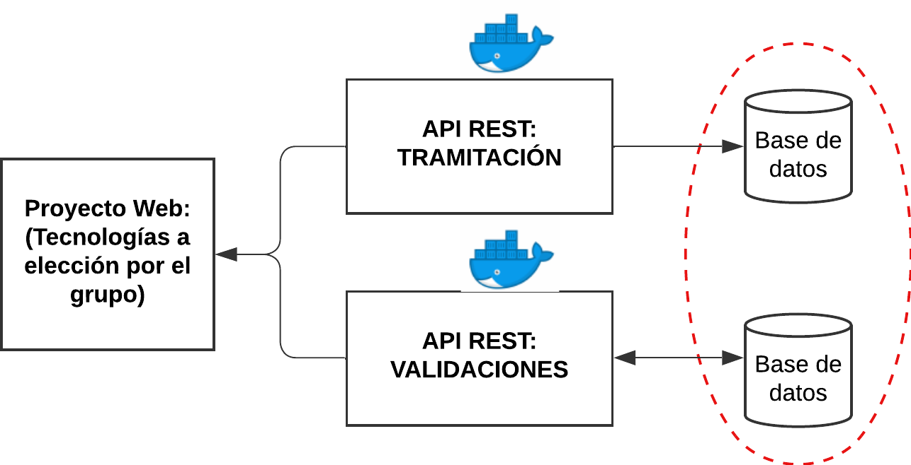
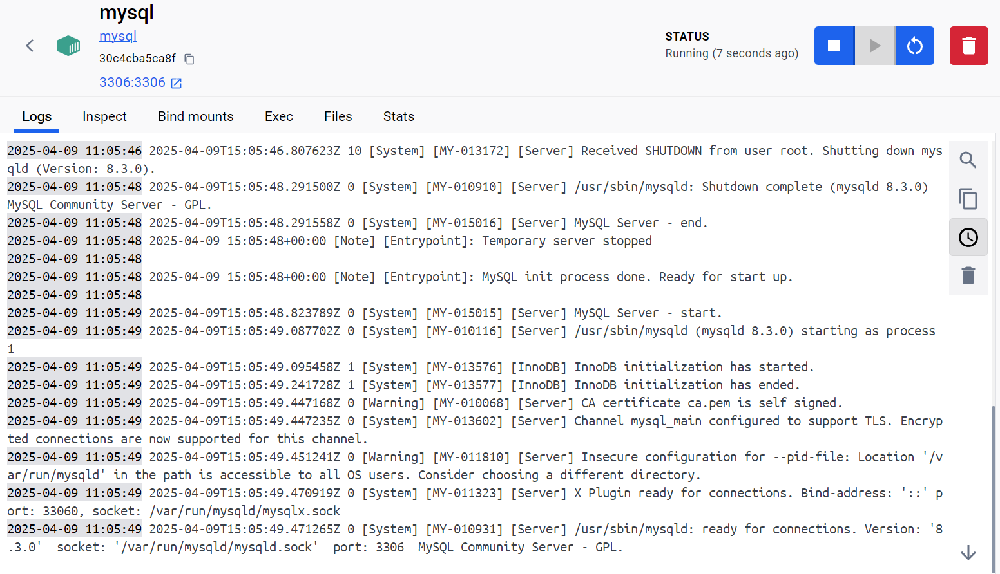
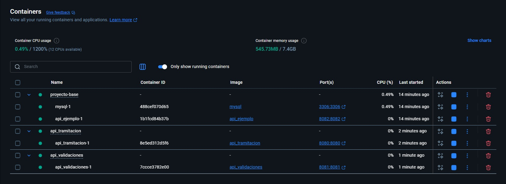
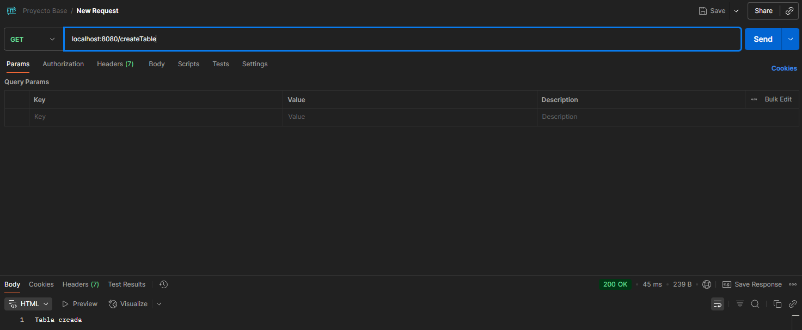
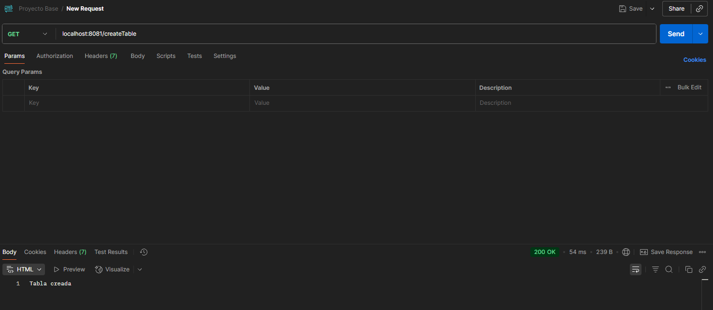
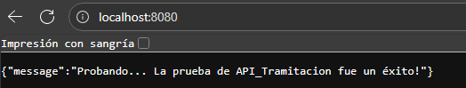
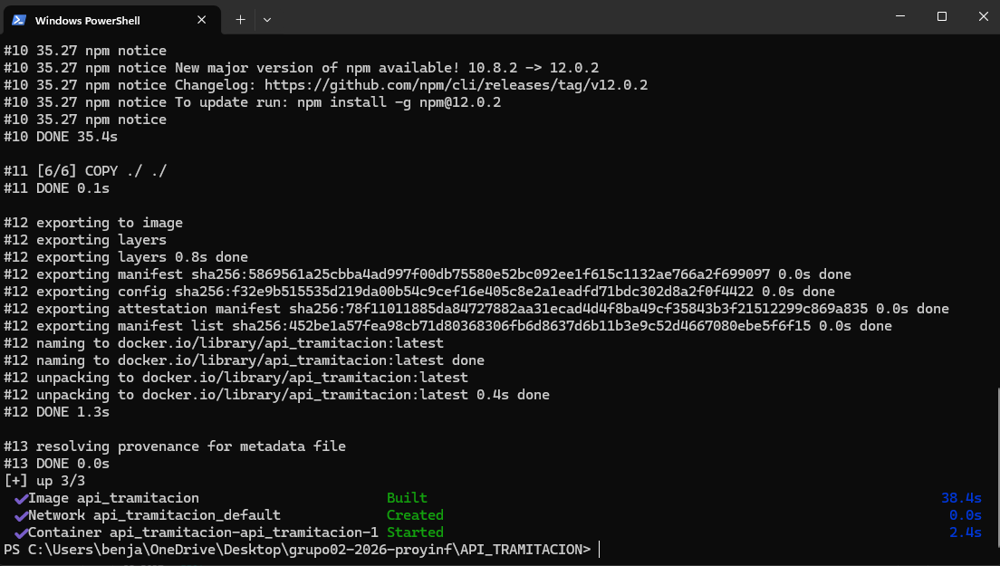
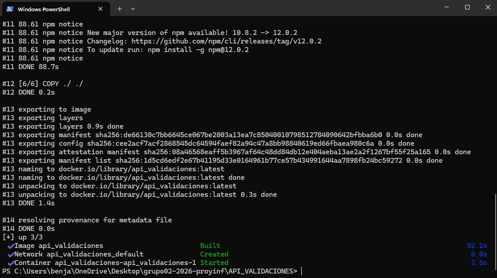
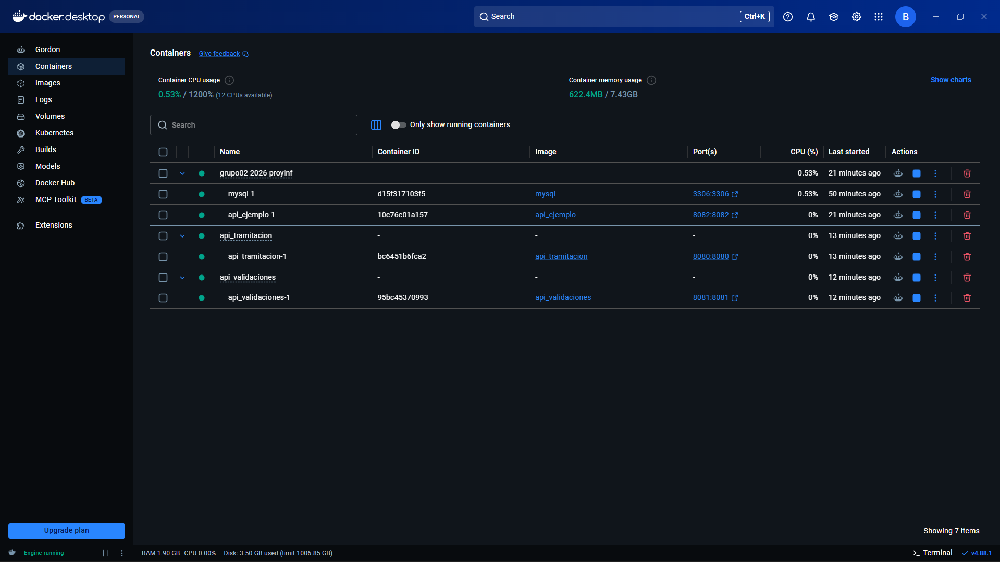

# Grupo 2

Este es el repositorio del grupo 2, cuyos integrantes son:

- Paula Castillo - ROL: 202473070-3
- Felipe Aguilera - ROL: 202473021-5
- Javiera Roda - ROL: 202473009-6
- Benjamin Vergara - ROL: 202473083-5
    - **Tutor**: Martina Tejo

## Wiki
Documentación del proyecto en la Wiki en el siguiente [enlace](https://gitlab.inf.utfsm.cl/inf236-cc-2026-2/grupo02-2026-proyinf/-/wikis/home).

# [NUEVO] INF236-2025-2-Proyecto Base

## Aspectos técnicos relevantes

- Se utilizó DBeaver para administrar y verificar las bases de datos MySQL.
- Es muy importante haber completado el levantamiento de los contenedores Docker y verificar que las API estén en ejecución antes de interactuar con el frontend.
- Las instrucciones detalladas para servir y visualizar la página web se encuentran en la sección final de este README.

## Requerimientos

Para utilizar el proyecto base debe tener instalado [Node.js](https://nodejs.org/en), [Docker](https://www.docker.com/) y se recomienda [Postman](https://www.postman.com/) para poder probar los endpoints de las APIs.

## Puntos a Considerar

La solución a desarrollar debe seguir los siguientes lineamientos (imagen referecial al final):
* Se debe considerar al menos dos API's:
    * **API_TRAMITACION:** Con todo lo referido a los pasos de solicitud, evaluación y firmas de documentos.
    * **API_VALIDACIONES:** Con todo lo referido a los procesos de activación, desembolso, cobranza y pagos de cuotas.
Si lo estiman necesario pueden añadir otras API's al proyecto, siempre y cuando cumplan con las reglas detalladas a continuación.
* Cada API contará con una base de datos mysql.
* Las API's deben ser construidas utilizando [Node.js](https://nodejs.org/en), además cuentan con [Express](https://expressjs.com/es/) para facilitar la construcción de estas.
* Las bases de datos deben estar en el mismo contenedor, pero no deben compartirse servicios.
* Cada servicio debe estar en un contenedor.
* El proyecto base solo considera los servicios.
* La tecnología de Frontend la define el grupo.


## Levantando el proyecto
### API_Ejemplo

Iniciaremos levantando la imagen de mysql en docker junto con la API de ejemplo. En una terminal dentro de la **carpeta principal**, escriba el siguiente comando:
```
docker compose up --build
```
La base de datos se inicializará con una tabla con información de países especificada en el archivo "API_EJEMPLO/init/init.sql".

Deben esperar a que los contenedores se inicien en su totalidad, pueden verificar esto en la interfaz de Docker. Luego, podrán probar los endpoints de la API, estos son:
```
GET: localhost:8082/api/pais
POST: localhost:8082/api/pais
PUT: localhost:8082/api/pais/:id
DELETE: localhost:8082/api/pais/:id
```
Sirven para leer, crear, modificar y eliminar registros de la base de datos, respectivamente.

> ⚠️ Cuando escriban ``docker compose up --build``, es normal que aparezcan errores al principio en la terminal. Esto pasa porque la API necesita conectarse a la base de datos. Si bien Docker levanta la BD y luego la api, la primera se levanta mucho más lento que la api! Así que la api lanza errores mientras espera que la base de datos esté lista. Es decir, no entren en pánico y esperen que diga: "Server running!". En caso de que en la aplicación de Docker Desktop comprueben que algunas api no estan corriendo, ejecuten el comando nuevamente o manualmente presionen el simbolo de "run" para las api afectadas.

### Configuración del Proyecto
Para el desarrollo del proyecto pueden quitar la API Ejemplo del archivo "docker-compose.yml" y eliminar su contenedor. **Noten que el proceso descrito a continuación levanta los contenedores uno a uno. Si lo desean, pueden investigar como juntar todo en el mismo docker-compose (como la API_EJEMPLO y la BD)!**

#### Bases de Datos
Para comenzar, deben tener ejecutándose el contenedor de la base de datos creado con la api de ejemplo, o pueden crearlo desde cero con el comando:
```
docker run -p 3306:3306 --name mysql -e MYSQL_ROOT_PASSWORD=password -d mysql
```



Ahora, crearemos las bases de datos. Para esto debemos entrar en el contenedor, con el siguiente comando:
```
 docker exec -it proyecto-base-main-mysql-1 mysql -uroot -p
```
Donde "proyecto-base-main-mysql-1" es el nombre del contenedor. Si no les coincide pueden revisarlo con "docker ps". Luego, deben ingresar la clave que en este caso es: **password**.

Una vez dentro del contenedor podemos crear las bases de datos:
```
create database Nombre;
```
Donde Nombre, deberá ser sustituido por: BDXX_TRAMITACION y BDXX_VALIDACIONES, donde XX corresponde al número de su grupo.

### API's
#### API_TRAMITACION
Se debe editar el archivo con nombre ".env" que se encuentra en las carpetas "API_TRAMITACION". Este debería contener lo siguiente:
```js
PORT_API = 8080
DB_USER = "root"
DB_PASSWORD = "password"
DB_NAME = "Nombre de la base de datos"
DB_PORT = 3306
DB_HOST = "host.docker.internal"
```
Deben cambiar DB_NAME por el nombre que le pusieron a la base de datos (BDXX_TRAMITACION).

Una vez creado el archivo, se levantará el contenedor de la API. Primero deben entrar en la carpeta de "API_TRAMITACION" y escribir:
```
docker compose up --build -d
```

#### API_VALIDACIONES
Los pasos a seguir son los mismos, únicamente deben fijarse que ahora esta API correrá en el puerto "8081".
```js
PORT_API = 8081
DB_USER = "root"
DB_PASSWORD = "password"
DB_NAME = "Nombre de la base de datos"
DB_PORT = 3306
DB_HOST = "host.docker.internal"
```

Una vez levantado todo, deberían poder ver en Docker todos sus contenedores corriendo:



Pueden probar los siguientes end-points en Postman para verificarlo:
```
GET: localhost:8080/createTable
```



```
GET: localhost:8081/createTable
```



Además, pueden poner en su navegador ```localhost:8080``` y/o ```localhost:8081```, y les debería salir el siguiente mensaje:



### Enjoy!

### Levantar toda la aplicación con Docker Compose

Desde la raíz del proyecto, ejecuta:

```bash
docker compose up --build
```

Esto inicia MySQL, las APIs de Tramitación y Validaciones, la API de ejemplo y el frontend. La página queda disponible en [http://localhost:5504](http://localhost:5504).

MySQL queda disponible para DBeaver en `localhost:3307` (usuario `root`, contraseña `password`). Dentro de Docker, las APIs siguen usando `db:3306`.

La inicialización de las bases de datos se ejecuta automáticamente solo cuando se crea el volumen MySQL por primera vez. Para reinicializar las tablas y usuarios de desarrollo:

```bash
docker compose down -v
docker compose up --build
```

Pasos seguidos para el levantamiento:

Capturas de pantalla:

* Ejecutar "docker compose up --build -d" en "API_TRAMITACION":


* Ejecutar "docker compose up --build -d" en "API_VALIDACIONES":


* Docker Desktop con todos los contenedores iniciados en su totalidad:


## Prototipo
* [Enlace al video explicando el prototipo.](https://youtu.be/3jvmSkmgGNc)

## Pasos extras a seguir luego del levantamiento para revisar la página web

- Muy importante: revisar que todas las APIs o contenedores de Docker estén corriendo y que estén creadas las bases de datos pedidas al inicio.

### 1. Iniciar el servidor local del Frontend

Ahora al hacer este comando: docker compose up -d --build

Se corren todos los Docker forma automática y se puede acceder a la pagina.

### 2. Abrir en el navegador

El número de puerto se puede cambiar en caso de que esté ocupado (cambiando en el docker-compose afuera de las carpetas).

http://localhost:5504

## Flujo de prueba:

Este flujo permite verificar de forma completa la pagina creada y las historias de usuario implementadas (`HU-01`, `HU-02`, `HU-03`, `HU-07`, `HU-08` y `HU-09`).

### Video de muestra del flujo y funcionamiento:


### 1. Usuarios creados

Para recorrer todos los roles del sistema se encuentran los siguientes usuarios en la base de datos:

| Rol | Usuario | Contraseña | Función en la prueba |
| :--- | :--- | :--- | :--- |
| Memorista | `benjamin.vergara` | `Memoria2026!` | Registrar propuesta, subir avances y cargar versión final. |
| Memorista | `paula.castillo` | `Memoria2026!` | Registrar propuesta, subir avances y cargar versión final. |
| Memorista | `felipe.aguilera` | `Memoria2026!` | Registrar propuesta, subir avances y cargar versión final. |
| Profesor Guía | `javiera.roda` | `Profesor2026!` | Evaluar avances y emitir el visto bueno para defensa. |
| Correferente | `facundo.salazar` | `Profesor2026!` | Evaluar y calificar el informe final del memorista. |


### 2. Paso a Paso

#### Paso 1: Ingreso como Memorista y registro de propuesta inicial (`HU-09`)
1. Iniciar sesión en la plataforma utilizando uno de los usuarios Memorista.
2. Acceder a la vista de Propuesta inicial y completar los antecedentes requeridos del tema de memoria para enviarlos a validación.
3. Qué se debe observar: la propuesta queda almacenada en estado `Pendiente de validación` y se redirige a la vista principal de seguimiento de la memoria.


#### Paso 2: Subida de avance por el Memorista (`HU-01`)
1. Manteniendo la sesión de Memorista, dirigirse a la sección Mis Avances.
2. Adjuntar un archivo en formato `.pdf` (sin marcar la casilla Versión final) y presionar Subir avance.
3. Qué se debe observar:
   - El sistema confirma la entrega registrando la fecha y hora exacta en la base de datos.
   - El documento aparece en el historial del memorista con estado `Esperando revisión`.

#### Paso 3: Evaluación del avance por el Profesor Guía (`HU-02`)
1. Cerrar sesión e ingresar como Profesor Guía.
2. Dirigirse a la sección Revisiones y seleccionar en la bandeja de pendientes el avance subido en el Paso 2.
3. Ingresar comentarios de retroalimentación en Observaciones, seleccionar el resultado `Avance suficiente` o `Necesita correcciones` y guardar la revisión.
4. Qué se debe observar:
   - La revisión queda vinculada al avance.
   - El estado del avance cambia a `Revisado`.
   - También se puede abrir el archivo que se esta revisando.


#### Paso 4: Visualización de notificaciones y retroalimentación en Memorista (`HU-03`)
1. Volver a iniciar sesión como Memorista.
2. Revisar el panel de inicio (actividad reciente) y la sección Mis Revisiones.
3. Qué se debe observar:
   - El sistema muestra las notificaciones y el historial actualizado con las observaciones exactas emitidas por la profesora guía, junto con la fecha y resultado de la revisión.

#### Paso 5: Carga de la versión final por el Memorista (`HU-01`)
1. Manteniendo la sesión de Memorista, ir nuevamente a la sección Mis Avances.
2. Adjuntar el documento y marcar la opción Versión final y confirmar el envío.
3. Qué se debe observar:
   - El documento queda registrado en el historial etiquetado como Versión Final (un 1 en la base de datos) y en estado `Esperando revisión`.
   - 
#### Paso 6: Evaluación del informe final por el Correferente (`HU-08`)
1. Cerrar sesión e ingresar con la cuenta de Correferente.
2. Cambiar a la pagina de evaluación del correferente y seleccionar al memorista que subió su versión final (solo se puede revisar el ultimo informe final subido).
4. Qué se debe observar:
   - El sistema almacena la calificación y las observaciones del correferente asociadas al informe final del estudiante.
   - Al igual que en el Profesor Guía se puede abrir el archivo que se esta revisando.

#### Paso 7: Visto bueno para defensa y notificación automática en Base de Datos (`HU-07`)
1. Cerrar sesión e ingresar nuevamente como Profesor Guía.
2. Ingresar a la sección Defensa y seleccionar el avance final de algún estudiante.
3. Revisar el checklist de requisitos previos (versión final registrada y aprobada) y presionar Emitir visto bueno.
4. Qué se debe observar:
   - En la interfaz, el estado de la memoria cambia a `Apto para defensa` y se muestra el mensaje de confirmación indicando que Jefatura de Carrera y Secretaría fueron notificadas.
   - Verificación en Base de Datos / API, Al emitir la autorización esta queda guarda en la base de datos mostrando a quien se le notifica y un mensaje diciendo a que memorista se le acepto la defensa.

#### Paso 8: Visualización de notificación y nota del avance final evaluado por el Correferente (`HU-09` - `HU-03`)
1. Volver a iniciar sesión como Memorista.
2. Revisar la sección Mis Revisiones y la sección defensa.
3. Qué se debe observar:
   - Mis Revisiones: el sistema muestra el mensaje dejado por el Correferente y la nota que le fue entregada.
   - Defensa: debe mostrar el mensaje de `Apto para defensa` y un mensaje de que el correferente reviso el archivo.
   
